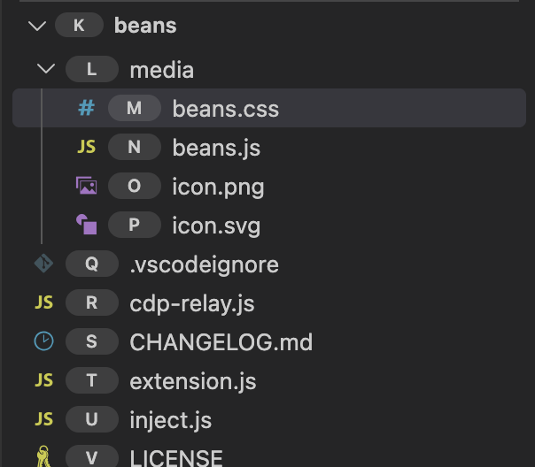

# Beans

Beans puts letter hints on every row of the VS Code sidebars (Explorer, Search, Source Control, Outline, Run and Debug, Extensions…), and on the headers of the views in them, so you can drive them by voice with [Talon](https://talonvoice.com). Say "click air" to open the row marked A, or to expand or collapse the view whose header has that hint. The Command Palette and other quick picks get number hints: "click 3".



Beyond clicking, you can right-click a row, scroll a list, resize the sidebars and the panel, and act on files and folders by hint: "open bat and cap", "file move harp past ink to drum", "stage air".

Beans is a preview. I use it every day on macOS; Windows and Linux should work but I haven't tried them.

## Requirements

- [Talon](https://talonvoice.com)
- The [Talon community](https://github.com/talonhub/community) repo in your Talon user folder
- The [command-server](https://marketplace.visualstudio.com/items?itemName=pokey.command-server) extension, which lets Talon run VS Code commands
- [beans-talon](https://github.com/david-tejada/beans-talon), the Talon commands for Beans

## Install

1. Install Beans from the VS Code Marketplace.
2. Clone the Talon commands into your Talon user folder (`~/.talon/user` on macOS and Linux, `%APPDATA%\Talon\user` on Windows):

   ```bash
   cd ~/.talon/user
   git clone https://github.com/david-tejada/beans-talon
   ```

3. Run **Beans: Relaunch with hints** from the Command Palette, or click **Relaunch with hints** in the warning Beans shows when it can't reach VS Code. VS Code quits and starts again, and the hints appear.

Run **Relaunch with hints** again each time you start VS Code another way, such as from the Dock. VS Code only opens the debug pipe Beans needs for the process that starts it, and its `argv.json` can't set the flag.

## What Beans does to VS Code

Extensions can't touch VS Code's interface, so Beans works around that. I want you to know exactly how before you install it:

- **It drives the workbench through VS Code's debug pipe.** VS Code is built on Chromium, which can be started with a private debug pipe (`--remote-debugging-pipe`). Through it, Beans runs its hint script and styles in each VS Code window, using the Chrome DevTools Protocol. It doesn't change any file inside VS Code, so the app's signature and updates stay intact.
- **Relaunch quits and restarts VS Code.** **Beans: Relaunch with hints** quits VS Code the normal way and starts it again. Unsaved changes come back from the backups VS Code keeps while you edit (tested on macOS); if `files.hotExit` is `"off"`, VS Code asks you to save them first.
- **A small relay process runs alongside VS Code.** Relaunch starts a detached Node process (run by VS Code's own Electron) that waits for VS Code to quit, starts it again with the debug pipe, and holds the pipe for as long as VS Code runs. It exits when VS Code does. If it's stopped first, VS Code closes too, because the pipe closes, so an error inside the relay is written to `beans-relay.log` in VS Code's user data folder and the relay carries on. If you cancel the quit, it gives up after two minutes, or sooner when you run Relaunch again, which replaces it.
- **A hidden status bar item carries requests.** When Talon runs a Beans command, the extension writes the request into a status bar item that Beans' styles hide, and the hint script in the page watches its text. Each window has its own status bar, so a request only reaches the focused window.
- **Only you can reach the relay.** VS Code opens no network port. The relay listens on a local socket in a new folder only your user account can open (a named pipe on Windows), and drops any connection that doesn't first send a random token. It writes the socket's address and the token to `beans-relay.json` in VS Code's user data folder, readable only by you, and removes it when VS Code exits. So other user accounts and sandboxed apps can't connect. Programs running as you could, but they could already control VS Code in other ways, such as by editing an installed extension.

### Platforms and editors

Beans is tested on macOS with VS Code. Windows and Linux, and forks of VS Code such as VSCodium, should work but haven't been tried. Snap and Flatpak installs on Linux may not restart with **Relaunch with hints**. Forks that change VS Code's interface can rename the CSS classes `media/beans.js` relies on (listed in `SELECTORS` at its top), which hides hints in those views.

## Commands

The Talon commands are in [beans-talon](https://github.com/david-tejada/beans-talon): the words in `beans.talon`, the target grammar in `beans.py`. The commands below that aren't in the Command Palette are meant to be called by Talon, through command-server.

- **Pick** (`beans.pick`): "click <letters>" clicks a sidebar row, "click <number>" a Command Palette row.
- **Right-click** (`beans.rowPoint`): "righty <letters>" right-clicks a sidebar row or view header, opening its context menu. On macOS, VS Code opens the menu at the real cursor, so a fake event can't place it: `beans.rowPoint` returns where the row is, as fractions of the window's width and height (title bar included, when VS Code uses the native one), and Talon moves the mouse there and right-clicks. The mouse stays on the row. The menu is native, so it has no hints: choose an item with the arrow keys, or type the start of its name, then press Enter.
- **Toggle** (`beans.toggle`): "beans toggle" shows or hides the hints.
- **Scroll** (`beans.scroll`, takes `"up"`, `"down"`, `"top"` or `"bottom"`, and optionally a hint): "downer", "upper bill", "upper all" (top), "downer all" (bottom), the same words as Rango. It scrolls the open quick pick, else the tallest sidebar list, or the list holding that row.
- **Inject** (`beans.inject`) runs the hint script again in every window. Beans also runs it when a command reaches a window that doesn't have the script, and asks you to say the command again.
- **Relaunch** (`beans.relaunch`) quits VS Code and starts it again with the debug pipe, held by `cdp-relay.js`. The relay gives up after two minutes if the quit is canceled, and is replaced by the next Relaunch.

### Resize commands

`beans.resize` takes `{ target, by }` (steps, negative to shrink), `{ target, to }` (pixels) or `{ target, max: true }`. The target is `"sidebar"`, `"secondary"` (the secondary sidebar), `"panel"`, or `{ hint }` for the sidebar view holding that row or header. It drags the divider in the page like a mouse would, so VS Code keeps the new size as if you'd dragged it. A step is 60px for a width and 44px (two rows) for a height. A collapsed view is expanded first. When VS Code stops the divider short, because a view is at its smallest or largest, Beans says where it stopped.

| Talon | What it does |
|---|---|
| side wider [N] / side narrower [N] | Sidebar width, by N steps (1 if left out) |
| side width N | Sidebar width, to N pixels |
| secondary wider / narrower / width | The same for the secondary sidebar |
| panel taller [N] / panel shorter [N] / panel height N | Height of the bottom panel (width if it's on a side) |
| view H taller [N] / view H shorter [N] / view H height N | Height of the sidebar view holding hint H |
| view H max | That view as tall as it can go |

### Target commands

These take one object, `{ target }`, where a target is `{ items: [{ hint } | { from, to }] }`. In Talon, a target is hints and ranges joined with "and": "harp past ink and made" is H to I, plus M. Ranges include both ends. Rows that aren't files, such as search matches, are skipped with a warning. The extension reads the rows' paths from the page through the debug pipe.

| Talon | Command | What it does |
|---|---|---|
| open T | `beans.open` | Opens files, toggles folders |
| split T | `beans.split` | Opens files to the side |
| file delete T | `beans.delete` | Moves to the Trash with the Explorer's own delete and confirmation; Cmd+Z (Ctrl+Z on Windows and Linux) in the Explorer undoes it. Rows from other views are deleted after Beans asks, into the Trash where there is one; in a remote window, or with `files.enableTrash` off, the question says the delete is for good |
| file move T to T / to root | `beans.move` (`destination`: a target or `"root"`) | Moves into that folder, or the folder of that file, with the Explorer's cut and paste; Cmd+Z or Ctrl+Z in the Explorer undoes it. Moves to root, and rows from other views, use an edit that can't be undone |
| file copy path T / file copy local T | `beans.copyPath`, `beans.copyRelativePath` | One path per line |
| expand T [deep N] | `beans.expand` (`levels`) | Expands folders, N levels deep, skipping folders that `files.exclude` hides |
| collapse T | `beans.collapse` | Collapses folders |
| parent T | `beans.collapseParent` | Collapses the folder holding each item |
| select T | `beans.select` | Selects the rows in the Explorer |
| file open folder T | `beans.revealInFinder` | Reveals in Finder, File Explorer, or the Linux file manager |
| stage T / unstage T | `beans.stage`, `beans.unstage` | Through the Git extension's API |
| discard T | `beans.discard` | Discards changes after asking; can't be undone |
| diff T | `beans.diff` | Opens the changes |
| file rename T | `beans.rename` | VS Code's rename box (first item only) |
| file create T / folder new T | `beans.newFile`, `beans.newFolder` | VS Code's new file or folder box, inside that folder or next to that file |
| find in T [text] | `beans.findInFolder` | Searches in that folder |

## Development

Beans has two halves:

- **`media/beans.js` and `media/beans.css` run in the window's page.** They label the visible sidebar rows, including ones half scrolled out of view, `a`…`z`, then `aa`, `ab`…, and click a row when asked.
- **`extension.js` runs in the extension host.** On startup, `inject.js` runs the page files in every window through the debug pipe, which `cdp-relay.js` holds (`relaunch.js` starts it). `target-commands.js` has the commands that act on files and folders by hint.

To run Beans from a checkout, link it into your extensions folder, then reload VS Code:

```bash
ln -s ~/Code/beans ~/.vscode/extensions/david-tejada.beans-0.1.0
```

After editing `media/`, run **Beans: Inject the hint script** to load the new version into every window. Changes to the extension's other files need **Developer: Reload Window**, and changes to `cdp-relay.js` a relaunch.
